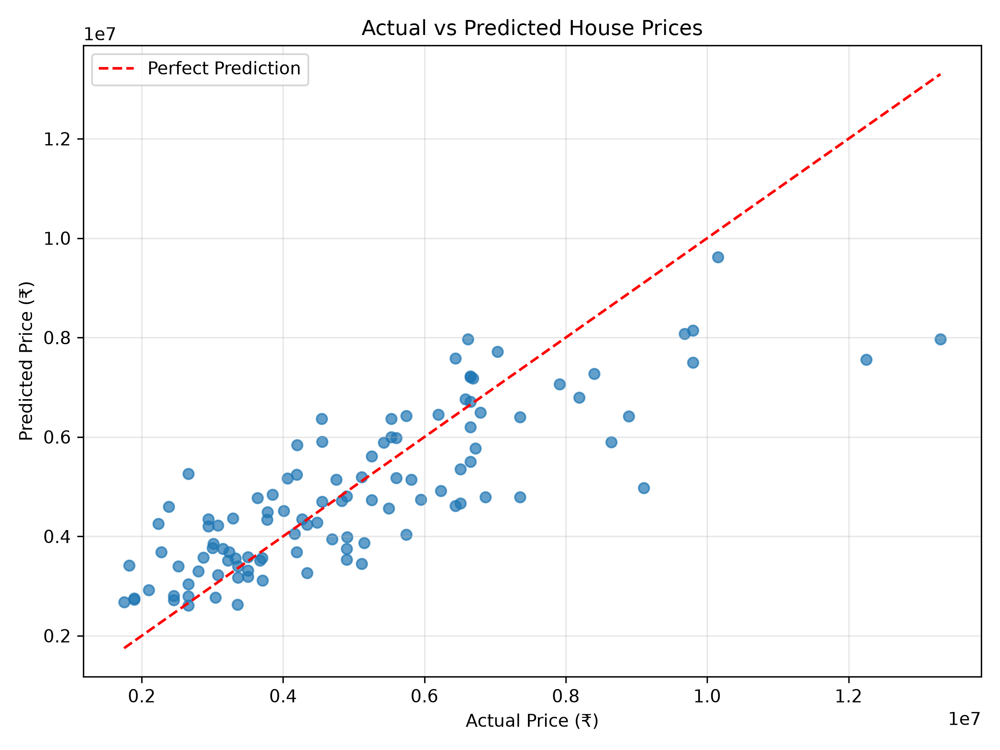

# House Price Prediction Using Linear Regression

## Project Overview

This project uses Python and machine learning to predict house prices based on property characteristics. A Linear Regression model is trained using a housing dataset and evaluated on a separate test set.

## Objectives

- Explore and analyze housing data.
- Prepare numerical and categorical features for machine learning.
- Train a Linear Regression model.
- Evaluate predictions using regression metrics.
- Visualize actual versus predicted prices.
- Predict an estimated price for a new property using user input.

## Technologies Used

- Python
- Pandas
- NumPy
- Matplotlib
- Scikit-learn
- Joblib

## Dataset

The dataset contains 545 house records and 13 columns, including:

- Price
- Area
- Bedrooms
- Bathrooms
- Stories
- Main road access
- Guestroom availability
- Basement availability
- Hot water heating
- Air conditioning
- Parking
- Preferred area
- Furnishing status

The dataset has no missing values according to the initial inspection.

## Methodology

1. Loaded and explored the CSV dataset using Pandas.
2. Checked the dataset structure, data types, descriptive statistics, and missing values.
3. Separated the target variable (`price`) from the input features.
4. Encoded categorical features using OneHotEncoder.
5. Split the dataset into training and testing sets using an 80:20 ratio.
6. Trained a Linear Regression model.
7. Evaluated the model using MAE, RMSE, and R².
8. Generated an actual-versus-predicted price scatter plot.
9. Saved the trained model using Joblib.
10. Created a command-line program to predict the estimated price of a new house.

## Model Performance

The model produced the following results on the test set:

- Mean Absolute Error (MAE): ₹970,043.40
- Root Mean Squared Error (RMSE): ₹1,324,506.96
- R² Score: 0.6529

The R² score indicates that the model explains approximately 65.29% of the variation in test-set prices. The prediction errors indicate that the model has room for improvement.

## Visualization

The actual-versus-predicted scatter plot compares the model's predictions with actual house prices. Points closer to the perfect-prediction reference line represent more accurate predictions.

## Running the Project

1. Install Python.
2. Clone or download the repository.
3. Create and activate a virtual environment.
4. Install the required libraries:

   `pip install -r requirements.txt`

5. Run the analysis and model training script:

   `python analysis.py`

6. Predict the price of a new house:

   `python predict_house.py`

The model file is generated at `model/house_price_model.pkl` when `analysis.py` runs successfully.

## Limitations

- Linear Regression may not capture all complex relationships affecting house prices.
- Predictions can differ considerably from actual prices.
- The dataset may not represent current prices in every location.
- The model is intended for educational demonstration, not professional property valuation.

## Conclusion

This project demonstrates a complete introductory machine-learning workflow, including data exploration, preprocessing, model training, evaluation, visualization, model saving, and new-input prediction.